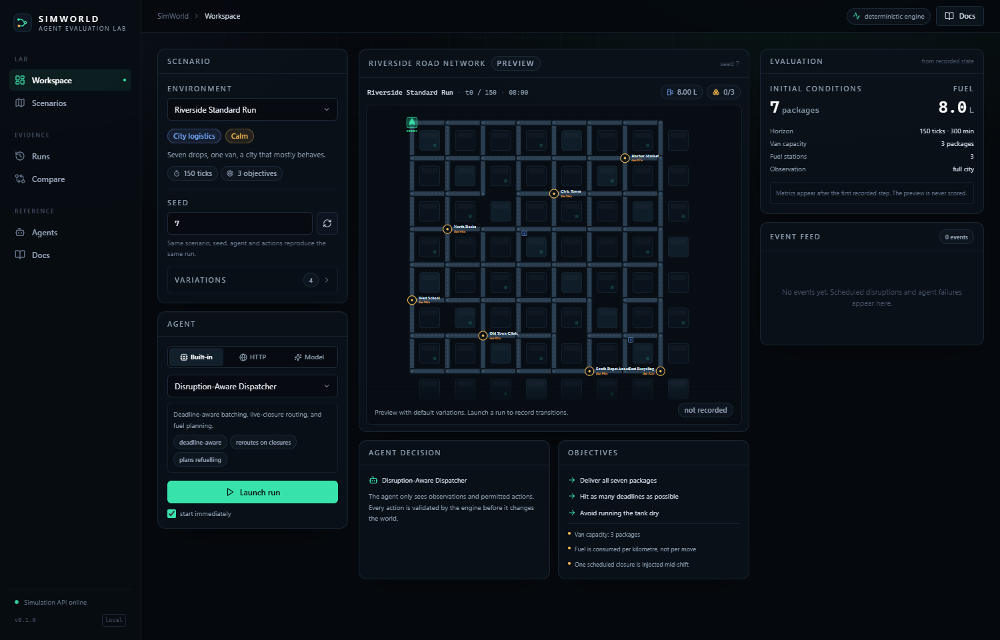
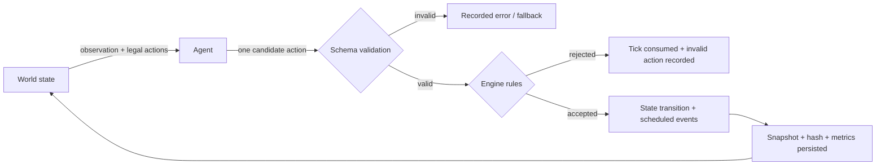
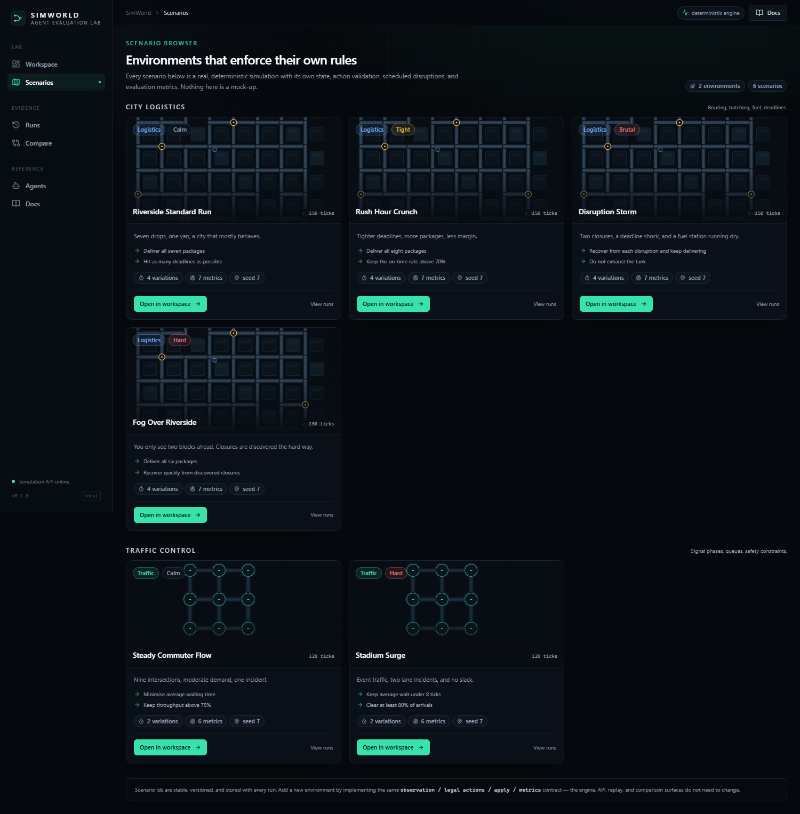
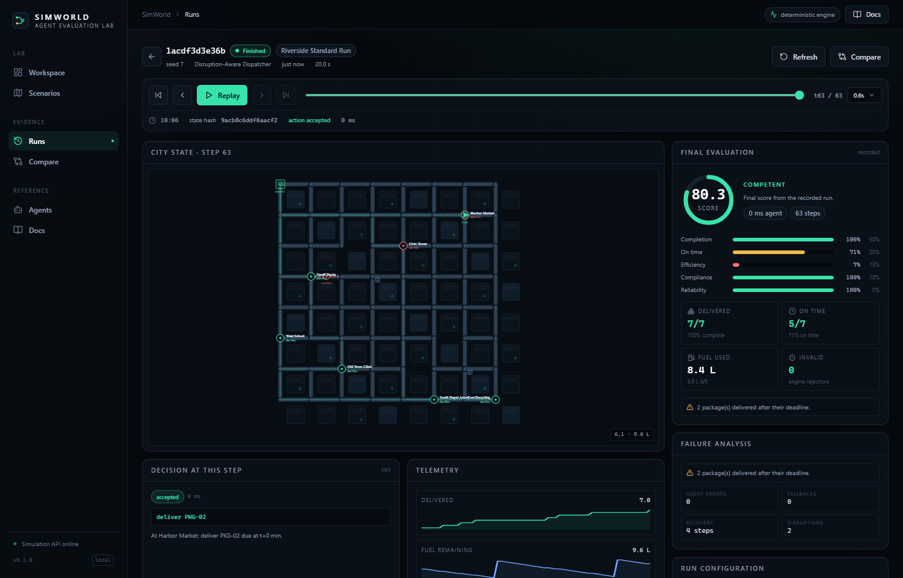

# SimWorld

** DEMO URL : https://drive.google.com/file/d/19oCWTagrqVmLvW3SiMF4-ZbLl_wJFdwj/view?usp=sharing

**Connect your agent. Put it in a world that fights back.**

SimWorld is an open-source simulation and evaluation lab for AI agents. It runs real, deterministic
simulations, validates every action an agent proposes, introduces disruptions mid-run, and scores what
actually happened — not what an agent says happened.

Built-in agents complete the scenarios on their own. External agents connect over a documented HTTP
contract. Language models can drive decisions through any OpenAI-compatible endpoint. The same
engine, replay, and comparison tools apply to all three.



## Why it is different

- **The engine is the authority.** An agent proposes; the engine validates movement, fuel, cargo,
  capacity, road closures, signal timing, and deadlines before any state changes. Invalid actions
  consume a tick and are counted.
- **Reproducible by construction.** Scenario layouts, deadlines, disruptions, and stocks are generated
  from a seed once and stored. The step function draws no randomness. Same config + same actions =
  same state hash.
- **Evidence, not narration.** Every step stores the action, the agent's reasoning, the validation
  result, the resulting state, a state hash, and measured latency. Replay reads those transitions.
- **Two working environments.** City logistics (routing, batching, fuel, deadlines) and traffic signal
  control (queues, minimum-green rules, incidents).
- **Honest AI integration.** If a model is unreachable or returns unusable output, SimWorld applies a
  deterministic fallback and records the error. It never pretends a model decided.
- **Alan integration.** A team Skill and a scheduled workflow are registered, and an MCP server exposes
  the evaluation workflow as tools for Alan agents.

## Quickstart

Requirements: Python 3.10+, Node 20+ (Node is only needed to rebuild the UI).

```bash
# 1. backend
cd backend
python -m pip install -r requirements-dev.txt
python -m uvicorn simworld.api.app:app --reload --port 8000

# 2. frontend, in a second terminal
cd frontend
npm install
npm run dev            # http://localhost:5173
```

For a production-style run, build the UI once and let FastAPI serve it:

```bash
cd frontend && npm run build
cd ../backend
python -m uvicorn simworld.api.app:app --host 0.0.0.0 --port 8000
# open http://127.0.0.1:8000
```

Or use the helper scripts:

```powershell
.\scripts\dev.ps1       # API + Vite
.\scripts\start.ps1     # build UI, serve everything on :8000
```

### Docker

```bash
docker compose up --build
# http://localhost:8000
```

See [docs/DEPLOYMENT.md](docs/DEPLOYMENT.md) for environment variables and production notes.

## The loop



The agent never touches the database or world state. It receives an observation and a list of actions
the engine will accept right now, and returns exactly one action.

## Scenarios that execute real rules

| Scenario | Environment | What makes it hard |
| --- | --- | --- |
| Riverside Standard Run | City logistics | Seven drops, fuel planning, one closure |
| Rush Hour Crunch | City logistics | Eight packages, 18% tighter deadlines |
| Disruption Storm | City logistics | Two closures, deadline shock, station runs dry |
| Fog Over Riverside | City logistics | Two-hop observation range; closures are discovered late |
| Steady Commuter Flow | Traffic control | Nine signals, queues, minimum green, one incident |
| Stadium Surge | Traffic control | High demand, two lane incidents |

Variations can shift disruption timing, fuel supply, deadline pressure, visibility, demand, and
incident count. Every combination is reproducible with a seed.



## Connect your own agent

SimWorld POSTs a JSON observation to your endpoint and validates the single action you return.

**Request**

```json
{
  "protocol": "simworld.agent.v1",
  "run_id": "7f3a1c9d2e40",
  "step": 12,
  "deadline_ms": 2500,
  "observation": { "...": "environment-specific state" },
  "legal_actions": [
    { "type": "move", "target": "3,3" },
    { "type": "pickup", "package_ids": ["PKG-01"] },
    { "type": "wait" }
  ]
}
```

**Response**

```json
{ "action": { "type": "move", "target": "3,3" }, "reasoning": "Closure forces a northern detour." }
```

A complete, dependency-free reference implementation is included:

```bash
python examples/external_agent.py --port 9100
# then point SimWorld at http://127.0.0.1:9100/agent
```

Test it from **Agents → External HTTP agent → Test connection**, which sends a real observation and
shows the latency, the returned action, whether it was offered, and whether the engine accepted it.

### Failure policy

| Situation | Behaviour |
| --- | --- |
| Timeout / connection failure | One deterministic fallback action, error recorded |
| Non-JSON / missing action / oversized response | Same fallback, error recorded |
| Structurally valid but illegal action | Reaches the engine, rejected, `invalid_actions` incremented |
| Three consecutive agent failures | Run terminates as `agent_unavailable` |

### Security boundaries

- `http`/`https` only, no credentials in URLs, redirects not followed.
- Loopback allowed in development only; private, link-local, and cloud-metadata addresses blocked.
- 200 ms–10 s timeout, 64 KiB response cap, 256 KiB API body cap.
- Agent output is parsed as data; SimWorld never executes agent-supplied code.
- Credentials come from environment variables and are never stored in runs or returned by the API.

## Built-in agents

| Agent | Environment | Strategy |
| --- | --- | --- |
| Disruption-Aware Dispatcher | City | Earliest-deadline batching, live-closure routing, fuel planning |
| Greedy Nearest Delivery | City | Nearest-first batching, no deadline planning |
| Static Shortest Path | City | Cached static routes; ignores closures and fuel (failure baseline) |
| Adaptive Pressure Controller | Traffic | Switches the signal with the largest opposing queue |
| Fixed-Cycle Timer | Traffic | Rotates phases on a fixed interval |

All built-ins are deterministic, credential-free, and use the same observation/action interface as
external agents. Comparisons are therefore like-for-like.

## Model-driven agents (verified)

Any OpenAI-compatible endpoint works: Ollama, vLLM, OpenRouter, OpenAI, Groq. The adapter sends a
compact decision view, accepts the model's action only after schema validation, and lets the engine
reject illegal proposals.

Verified locally with **Ollama + qwen2.5:1.5b-instruct** (CPU): real actions, no fallback, ~4–7 s per
decision. A smaller 0.5B model is fast but tends to choose `wait`, which is exactly the kind of failure
the evaluation exposes.

```bash
ollama pull qwen2.5:1.5b-instruct
ollama serve
# then choose Agent → Model in the workspace
```

Configuration:

```bash
SIMWORLD_LLM_BASE_URL=http://127.0.0.1:11434/v1
SIMWORLD_LLM_MODEL=qwen2.5:1.5b-instruct
SIMWORLD_LLM_API_KEY_ENV=OPENAI_API_KEY
```

If the endpoint is unavailable the UI says so and runs record fallbacks instead of fabricating model
decisions.

## Alan integration

Verified platform records (team `SimWorld`):

- **Skill** `simworld-evaluation` — enabled, validated. Teaches an Alan agent to run SimWorld
  experiments, read evidence, and never invent metrics.
- **Workflow** `SimWorld weekly agent benchmark` — draft schedule (Mondays 06:00 UTC, local runtime),
  disabled until the team enables it. It runs `scripts/nightly_benchmark.py` and reports real aggregates.
- **MCP server** `mcp_server/server.py` — stdio JSON-RPC with six tools:

  `simworld_list_scenarios`, `simworld_start_run`, `simworld_run_experiment`,
  `simworld_get_metrics`, `simworld_explain_failure`, `simworld_compare_runs`

The MCP protocol is verified end-to-end by `scripts/mcp_smoke.py`, which performs the handshake, lists
tools, runs a scenario, compares two runs, and executes a 2×2 experiment. Connecting the MCP server to
a cloud Alan team requires a publicly reachable URL; see
[docs/ALAN_INTEGRATION.md](docs/ALAN_INTEGRATION.md) for the exact status and steps.

## Evaluation

Scores are computed only from recorded transitions and measured agent latency.

**City logistics score**
`50% completion + 20% on-time + 15% fuel efficiency + 10% compliance + 5% reliability`

**Traffic control score**
`45% throughput + 30% wait-time + 15% congestion + 5% compliance + 5% reliability`

Component metrics and a failure list always appear next to the score, so one aggregate cannot hide a
broken objective. Metric definitions are served live at `GET /api/metrics`.



## Reproducibility and replay

- The run stores scenario id and version, seed, agent descriptor, resolved options, and the complete
  initial configuration.
- Initial conditions are generated once from the seed; they are never regenerated during a run.
- Step transitions are pure: no RNG, no wall-clock dependence.
- Replay reads the recorded per-step snapshots; it does not invent an animation. The UI also shows the
  state hash at each step.
- Experiments pair every seed with every selected agent and report mean ± standard deviation.

## Testing

```bash
cd backend
python -m pytest -q
```

87 tests cover engine rules, fuel, deadlines, closures, scheduled events, terminal states, traffic
signal rules, determinism, external-agent validation/timeouts/SSRF, LLM fallback and schema
tolerance, metric math, replay reconstruction, run lifecycle, experiments, the documented example
agent, the MCP tools, and the HTTP API.

## Project layout

```
backend/
  simworld/
    engine/          pure deterministic domain layer
      city.py        city logistics world
      traffic.py     traffic signal world
      actions.py     strict action contract
      scenarios.py   seeded scenario catalogue
    agents/          built-in, external HTTP, and LLM adapters
    evaluation.py    scores, metric definitions, aggregation
    store.py         SQLite persistence
    service.py       lifecycle, replay, experiments
    api/             FastAPI app and schemas
  tests/
frontend/            React + TypeScript + Tailwind SPA
examples/            reference external agent
mcp_server/          MCP stdio bridge for Alan
scripts/             benchmark, MCP smoke test, dev/start helpers
docs/                architecture, API, Alan, deployment, demo
```

## API

Full interactive docs: `http://127.0.0.1:8000/api/docs`. Summary in [docs/API.md](docs/API.md).

| Method | Path | Purpose |
| --- | --- | --- |
| GET | `/api/scenarios` | Scenario catalogue |
| POST | `/api/runs` | Create a run |
| POST | `/api/runs/{id}/start` | Start auto-stepping |
| POST | `/api/runs/{id}/pause` | Pause |
| POST | `/api/runs/{id}/step` | Advance one tick |
| POST | `/api/runs/{id}/reset` | Restore the initial state |
| POST | `/api/runs/{id}/disrupt` | Inject a live disruption |
| GET | `/api/runs/{id}/replay` | Recorded transitions |
| POST | `/api/experiments` | Multi-seed, multi-agent suite |
| POST | `/api/agents/test` | Connection test with a real observation |

## Demo

A five-minute demonstration script is in [docs/DEMO.md](docs/DEMO.md). It uses the built-in
dispatcher for speed, injects a live closure, finishes the run, opens the replay, and compares three
strategies on the same seed.

## Known limitations

- Logistics is single-vehicle. The world interface supports multiple entities, but cooperative
  multi-agent logistics is not implemented.
- SQLite and in-process run execution target a single worker. Multi-worker deployments need a shared
  database and a run queue.
- Per-step snapshots favour exact replay over storage size; runs are capped at 400 steps.
- Local models are slow on CPU. The demo uses a built-in agent for the fast path and a model run for
  the AI evidence.
- Scores are only comparable within the same scenario.
- Simulated success is not evidence of real-world safety.

## License

MIT. See [LICENSE](LICENSE).
