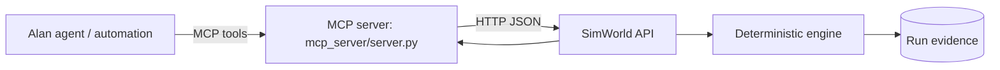

# Alan integration

This document separates what was **verified** from what still requires an external deployment. It does
not claim a live cloud MCP connection that was not observed.

## What was verified

| Item | Evidence |
| --- | --- |
| Team Skill `simworld-evaluation` | Created and validated by the Alan platform (`validation.valid = true`, enabled). It instructs Alan agents to use SimWorld tools and to never invent metrics. |
| Alan workflow `SimWorld weekly agent benchmark` | Created as a real Alan automation record with a Monday 06:00 UTC schedule, local runtime, 30-minute timeout, one retry. It is deliberately **disabled (draft)** so it does not start recurring agent sessions without the team's consent. |
| MCP server | Speaks JSON-RPC 2.0 over stdio. Handshake (`initialize`), `tools/list`, and `tools/call` verified with `scripts/mcp_smoke.py`, which ran a real scenario, a comparison, a failure explanation, and a 2×2 experiment. |
| Model-driven decisions | Verified end to end with Ollama `qwen2.5:1.5b-instruct` on seed 7: 7/7 delivered, 75 steps, score 73.57, 0 invalid actions, 0 fallbacks. The model chooses goals; the router emits moves. Evidence: `docs/evidence/model-run.md`. |
| External agent | Verified over HTTP with the included example agent and an engine-complete run. |

Skill and workflow live in the Alan team `SimWorld` (`4ee0a5e8-c387-4630-b936-5857c63c970c`). The
workflow URL is returned by the Alan API when the record is read.

## Integration shape



The MCP bridge is deliberately thin: it contains no simulation rules. It calls the same public API a
human uses, so an Alan agent cannot bypass validation or manufacture metrics.

## MCP tools

| Tool | Purpose |
| --- | --- |
| `simworld_list_scenarios` | Environments, objectives, constraints, variations |
| `simworld_start_run` | One reproducible run; waits and returns score + components + failures |
| `simworld_run_experiment` | Multiple agents × seeds; returns mean/std and per-run evidence |
| `simworld_get_metrics` | Stored metrics for a run |
| `simworld_explain_failure` | Failures, invalid actions, late deliveries, disruption timeline |
| `simworld_compare_runs` | Side-by-side metrics for 2–4 runs |

## Running the bridge

```bash
# SimWorld API must be running
export SIMWORLD_API_URL=http://127.0.0.1:8000
python mcp_server/server.py
```

The server reads one JSON-RPC message per line from stdin and writes responses to stdout. Protocol
logging goes to stderr.

Manual handshake:

```json
{"jsonrpc":"2.0","id":1,"method":"initialize","params":{"protocolVersion":"2024-11-05","capabilities":{},"clientInfo":{"name":"manual","version":"1"}}}
{"jsonrpc":"2.0","id":2,"method":"tools/list"}
{"jsonrpc":"2.0","id":3,"method":"tools/call","params":{"name":"simworld_list_scenarios","arguments":{}}}
```

## Connecting it to Alan

Alan supports team plugins and MCP. Register the server wherever your team's MCP configuration lives:

- **Local or self-hosted:** use the stdio command `python mcp_server/server.py` from an environment that
  has the SimWorld repository and a reachable `SIMWORLD_API_URL`.
- **Cloud Alan:** the server must be reachable from Alan's network. Deploy it behind HTTPS with
  authentication, or run the API and MCP bridge on a machine Alan can reach, and register that URL.
  Do not expose an unauthenticated MCP bridge to the public internet.

The exact plugin registration UI is part of Alan's product surface and can change; see Alan's
documentation for **Plugins and MCP** for the current steps.

## Why it is a genuine integration

The integration changes how work happens:

1. An Alan agent can start a real simulation and must wait for the engine's result.
2. Its tool output is engine evidence, not a model's opinion.
3. A failing strategy can be explained from stored steps and disruptions, then rerun with the same seed.
4. The Skill enforces reporting rules — scenario, seed, agent, run id, component metrics, failures.

What it does **not** do: it does not put a language model inside the simulation rules, and it does not
allow the model to declare success. Alan or any other model only proposes actions or reads recorded
results.

## Scheduled benchmark

`scripts/nightly_benchmark.py` runs three suites (city standard, disruption storm, traffic steady) over
three seeds and two or three agents, then writes `docs/benchmarks/latest.md` and prints the summary. The
Alan workflow is configured to run exactly that command. It is disabled by default.

To enable it, open Alan → Automations → `SimWorld weekly agent benchmark`, confirm the local runtime is
online, and turn it on. To run it manually now:

```bash
python scripts/nightly_benchmark.py
```

## Remaining external blocker

A public deployment and a cloud Alan team MCP registration were not performed because this environment
has no hosting credential, public URL, or GitHub credential. The local MCP protocol, the Alan records,
the API, and the model integration are verified; the only missing step is network exposure and team
registration.