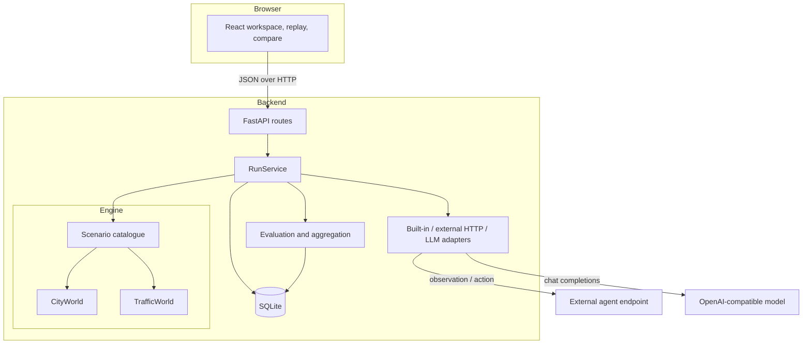
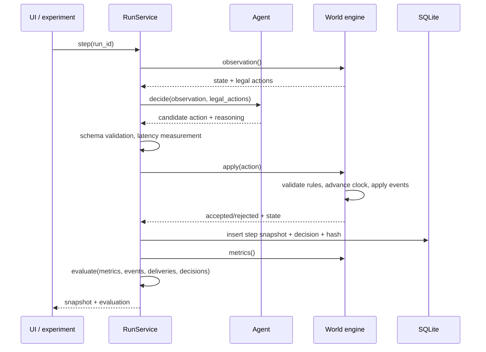
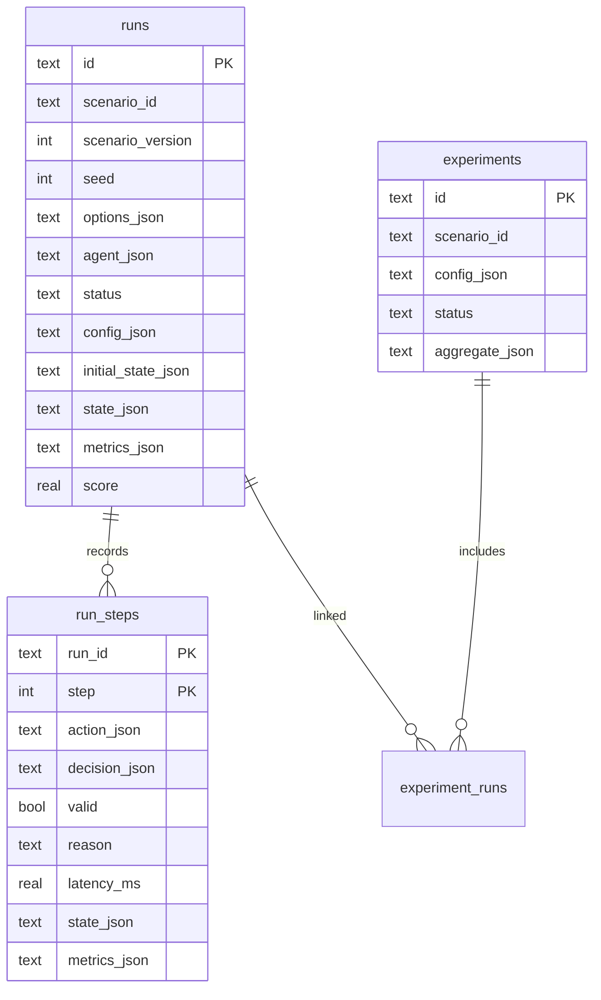

# Architecture

SimWorld separates the world, the agent, the orchestration layer, and the evidence store. The
boundaries are enforced by imports: the engine package has no FastAPI, HTTP, or database imports.

## Module responsibilities

| Module | Owns | Must not |
| --- | --- | --- |
| `engine/actions.py` | Strict action wire format | Know about HTTP or databases |
| `engine/city.py` | Route graph, van, packages, fuel, closures, metrics | Call an agent or read env vars |
| `engine/traffic.py` | Signals, queues, incidents, throughput | Call an agent |
| `engine/scenarios.py` | Seeded initial conditions and variation validation | Mutate a running world |
| `agents/*` | Turn an observation into a candidate action | Mutate world state |
| `evaluation.py` | Scores and aggregates from recorded metrics | Trust agent-reported values |
| `service.py` | Lifecycle, persistence, replay, experiments, fallbacks | Contain environment rules |
| `store.py` | SQLite schema and JSON serialization | Contain business rules |
| `api/*` | HTTP contracts validation and error mapping | Reimplement engine rules |
| `frontend/*` | Display and control | Compute authoritative metrics |

## The step pipeline

Invalid actions still advance the clock and are persisted. Agent failures apply one deterministic
fallback action; three consecutive failures terminate the run.

## Determinism

- `scenarios.py` is the only place a random number generator runs. It receives a seed and produces a
  complete, JSON-serializable configuration: blocked roads, package destinations, deadlines, stocks,
  and the scheduled event plan.
- The engine classes contain no RNG and no wall-clock calls. `apply()` is a pure transition over
  explicit state.
- Live disruptions are explicit user actions recorded in the same event log.
- Each snapshot includes a `state_hash` over vehicle, packages, stations, road status, step, and
  status. Tests compare hashes after identical action sequences.

## Persistence model

`initial_state_json` and `state_json` on the run row are authoritative `to_dict()` world states used to
resume execution. Per-step `state_json` is a display snapshot used by replay. The replay API also
returns `initial_snapshot` for step 0.

## Adding a new environment

1. Implement a world class with:
   - `observation() -> dict`
   - `legal_actions() -> list[dict]`
   - `apply(Action) -> ApplyResult`
   - `metrics() -> dict`
   - `terminal() -> (bool, reason)`
   - `snapshot()`, `to_dict()`, `from_dict()`, `state_hash()`, `inject(event)`
2. Add a scenario builder that turns `(scenario_id, seed, options)` into an explicit config.
3. Register it in `scenarios.build_world` and `world_from_state`.
4. Add at least one built-in agent that can complete the environment.
5. Add engine tests for valid/invalid actions, terminal conditions, and determinism.
6. The API, replay, comparison, and UI renderers already work with any state that exposes the common
   shape; add a map renderer if the visual surface is new.

The traffic environment is a working example of adding a second world without touching the run
service or the agent protocol.

## Failure handling

| Layer | Failure | Result |
| --- | --- | --- |
| Agent adapter | Timeout, bad JSON, bad action shape | `AgentError`, deterministic fallback, recorded |
| Engine | Illegal action | Rejected, tick consumed, invalid counter |
| Run service | 3 consecutive agent errors | World fails with `agent_unavailable` |
| Run service | Pause/reset races | Per-run re-entrant lock; autoplay stops before reset |
| API | Bad request | 400/404/413/422 with a concrete message |
| Model | Unreachable or unusable | Fallback, `agent_errors`, shown in UI |