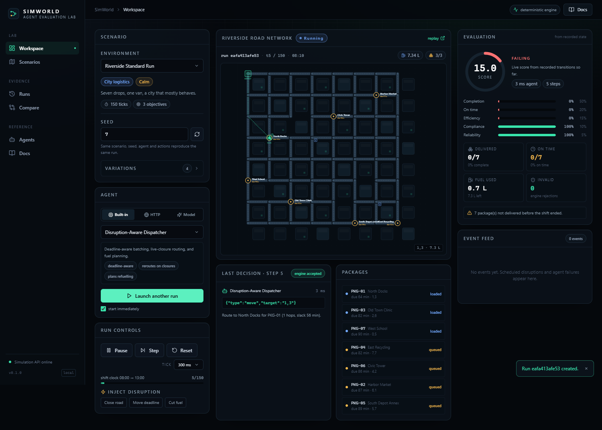
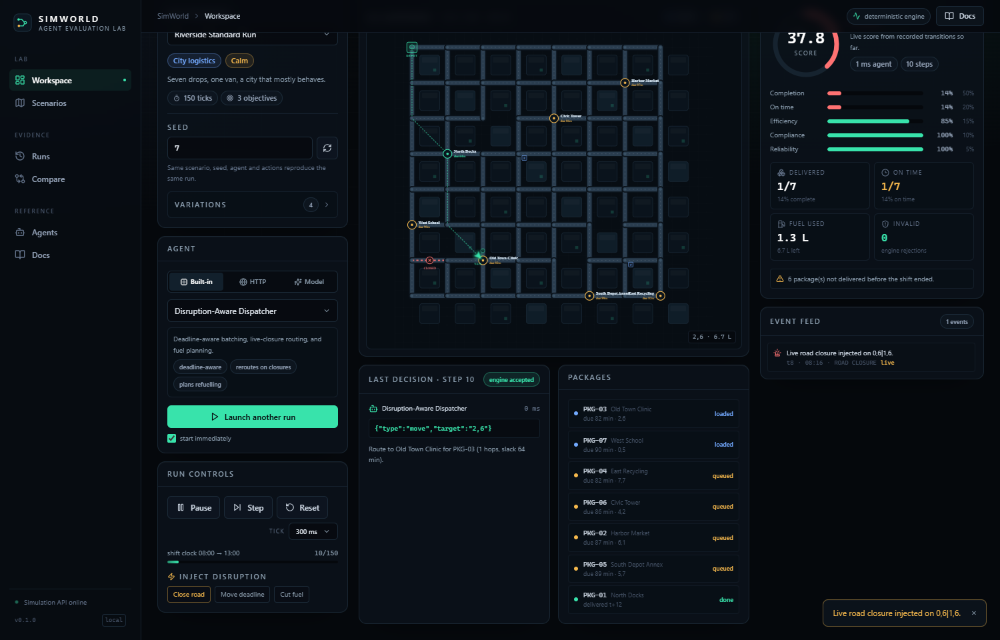
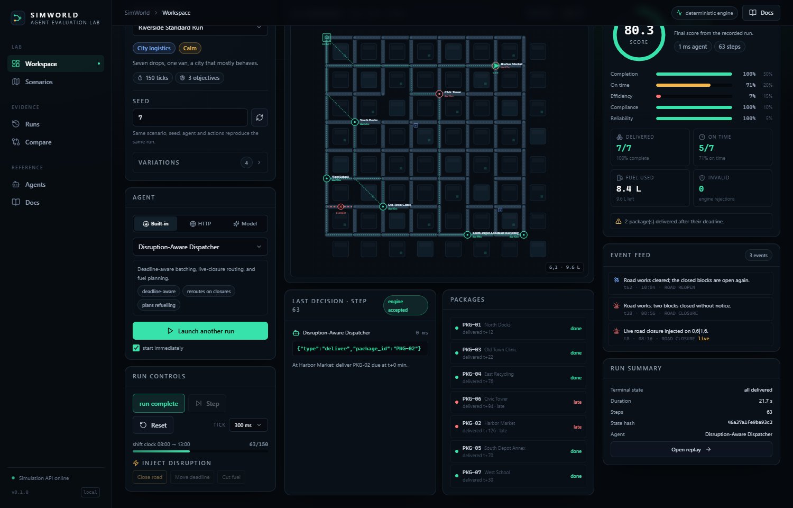
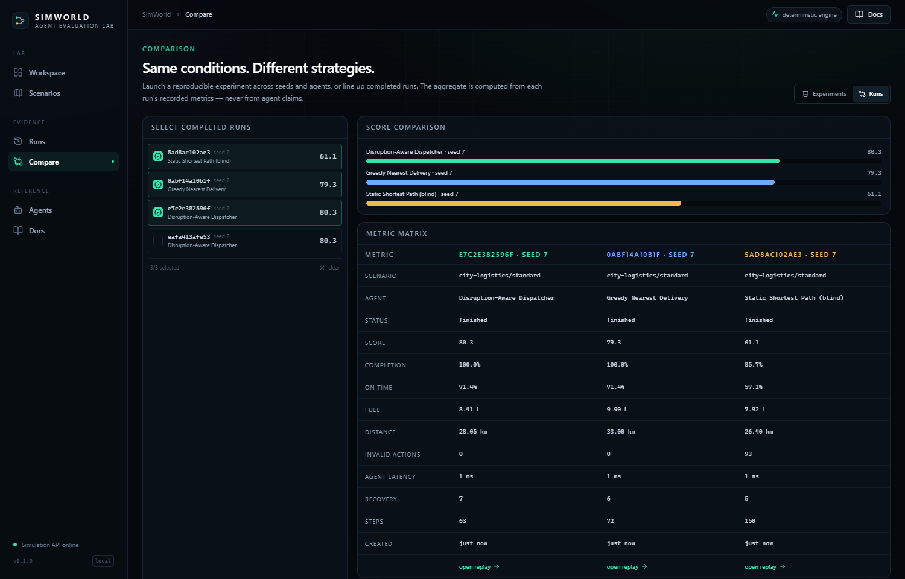
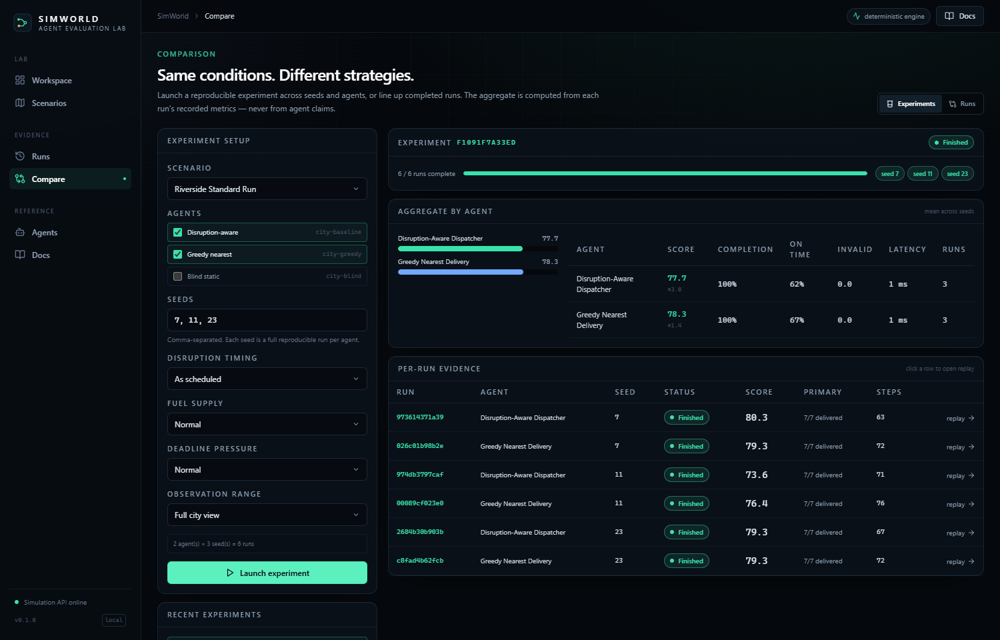

# Demo script (5–7 minutes)

Everything below uses the real application. No step fakes a metric, a model decision, or a connection.

## 0. Start

```bash
cd backend
python -m uvicorn simworld.api.app:app --port 8000
```

Open `http://127.0.0.1:8000` (production build) or `http://localhost:5173` (Vite dev).

## 1. Frame the workspace (30 s)

The left column is the scenario and agent configuration, the center is ground-truth simulation state,
and the right is the evaluation computed from recorded steps. Point out the preview label: a preview is
never scored.


## 2. Launch a real run (45 s)

- Scenario: **Riverside Standard Run**, seed **7**
- Agent: **Disruption-Aware Dispatcher**
- Click **Launch run**

The van loads packages, moves one road per tick, burns fuel per kilometre, and consumes simulation
time. The map is the engine state, not an animation.



## 3. Make the world fight back (30 s)

Wait until the run is a few ticks in, then click **Close road**. The closure is injected live, added to
the event feed, and the agent's next routes avoid it. Every action after the disruption is recorded.



## 4. Finish and read the evidence (45 s)

Let the run finish. The final score is **80.3** on seed 7 for this agent. Point out:

- Completion 100%, on-time 71%, fuel used 8.4 L, invalid actions 0.
- Two late packages, listed as real failures.
- Agent error 0, fallbacks 0.



## 5. Replay the failure (60 s)

Click **Open replay**. Drag the slider to the middle. The map, decision, reasoning, fuel, deliveries, and
event timeline all come from the stored step records. The state hash changes as you move.


Pause on the disruption step and explain what the agent saw and what it did next.

## 6. Compare strategies (60 s)

Open **Compare → Runs**. Select three runs from the same scenario and seed:

- Disruption-Aware Dispatcher
- Greedy Nearest Delivery
- Static Shortest Path (blind)

Show the score bars and the metric matrix. The blind baseline hits ~93 invalid actions and strands the
van; the dispatcher finishes with none. Same conditions, different behaviour.



## 7. Reproducible experiments (45 s)

Open **Compare → Experiments**, choose two or three agents and seeds `7, 11, 23`, and launch. The results
show mean ± std per agent and a per-run evidence table. Open any run to inspect it.



## 8. Bring your own agent (45 s)

Start the sample agent:

```bash
python examples/external_agent.py --port 9100
```

Open **Agents → External HTTP agent**, keep `http://127.0.0.1:9100/agent`, and click **Test connection**.
It sends a real observation and shows latency, the returned action, whether it was offered, and whether
the engine accepted it. Then select **HTTP** as the agent mode in the workspace and launch a run.

## 9. Model-driven agent (optional, ~5 minutes)

If Ollama is running with `qwen2.5:1.5b-instruct`:

- Agent mode: **Model**
- Launch a run

Each decision takes ~4–7 s on CPU. The replay shows the model's reasoning and the engine's validation.
If the endpoint is missing, the UI says so and the run records fallbacks rather than pretending.

## 10. Alan integration (30 s)

Show `docs/ALAN_INTEGRATION.md` and run:

```bash
python scripts/mcp_smoke.py
```

It performs the MCP handshake, runs a scenario, explains a failure, compares two runs, and executes a
2×2 experiment. Then show the Alan Skill and the disabled weekly benchmark workflow.

## Fallback if a live service fails

- The repo contains all screenshots above plus their run data in the QA database used to record them.
- Built-in agents need no credentials, so steps 2–7 always work offline.
- If Ollama is unavailable, say so and use the model status panel as evidence of honest fallback — do
  not claim model execution.
- If the MCP bridge cannot reach the API, `scripts/mcp_smoke.py` fails with the exact blocker; show that
  instead of claiming a connection.

## Known-good seed

Seed **7**, `city-logistics/standard`, `city-baseline` produces:

- score 80.3, 7/7 delivered, 5/7 on time, 8.4 L consumed, 0 invalid actions, 63 steps.

Those values come from the run stored during QA; they will reproduce exactly with the same build.