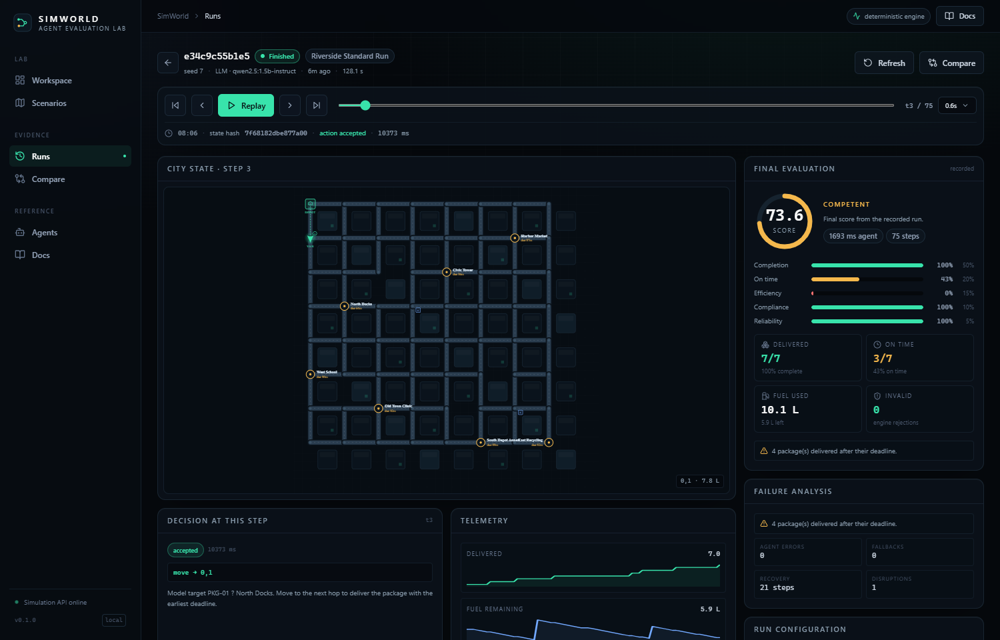

# Verified model-driven run

This is a real run captured from the running application. No values below were typed by hand.

| Field | Value |
| --- | --- |
| Run | `e34c9c55b1e5` |
| Environment | `city-logistics/standard` |
| Seed | 7 |
| Agent | OpenAI-compatible model, Ollama `qwen2.5:1.5b-instruct` (CPU) |
| Result | finished · all packages delivered |
| Steps | 75 |
| Score | **73.57** |
| Packages | 7 / 7 delivered · 3 on time · 4 late |
| Fuel | 10.07 L consumed |
| Invalid actions | **0** |
| Agent errors / fallbacks | **0 / 0** |
| Mean decision latency | 1.69 s (model calls only on target changes; the router fills the gap) |
| Recovery after first disruption | 21 steps |

Raw evidence: `model-run.json` (every step, action, reasoning, latency, validity, failure list).



## Why the agent is a supervisor

The first implementation asked the 1.5B model for a raw movement action on every tick. It produced
spatially incoherent moves and never loaded a package: 0 deliveries, 102 rejected actions. That is a
valid result to report, but it says more about asking a small model to do pathfinding than about the
agent's strategy.

The current model agent separates concerns:

1. The model sees a compact observation with each package's next hop, status, deadline, fuel, and
   curated legal actions.
2. It chooses the **goal**: which batch to load, which delivered package to serve, or which undelivered
   package to pursue.
3. A deterministic router turns that goal into one legal move per tick and recomputes around closures.
4. The engine validates every move exactly as it does for any other agent.

The model's decisions and reasoning are stored. Router ticks are labelled "Following the model-selected
target …". Fuel guards are explicit and can override a goal when the tank would not survive it. This is
why the run has zero invalid actions and zero fallbacks while still being genuinely model-driven.

## First decisions

| Step | Action | Reasoning (verbatim) | Latency |
| --- | --- | --- | --- |
| 1 | pickup PKG-01, PKG-02 | "Earliest deadlines are 64 and 87 minutes, respectively, and both can be delivered from the depot." | 19.98 s |
| 2 | pickup PKG-03 | "The package with the earliest deadline is at node 2, and it can be picked up from node 0." | 9.73 s |
| 3 | move 0,1 | "Model target PKG-01 → North Docks." | 8.82 s |
| 4–6 | move along the route | "Following the model-selected target PKG-01 toward 1,3." | <1 ms |
| 7 | deliver PKG-01 | "At North Docks; delivering PKG-01 due at t+64 min." | — |

## Failure list (recorded)

- 4 packages were delivered after their deadline.
- No invalid actions, no agent errors, no fallbacks.
- The run still delivered every package before the shift ended.

This is a useful result: the model made locally reasonable choices, but deadline management was weaker
than the deterministic dispatcher (80.3 on the same seed), and the evaluation shows exactly which
packages were late. A single score would hide that.

## Reproduce

```bash
ollama pull qwen2.5:1.5b-instruct
ollama serve
# In the UI: Agent → Model, scenario Riverside Standard Run, seed 7, launch.
```

CPU latency will vary. If the model is not reachable, the UI reports it and the run records fallbacks;
it never claims a model decision that did not happen.